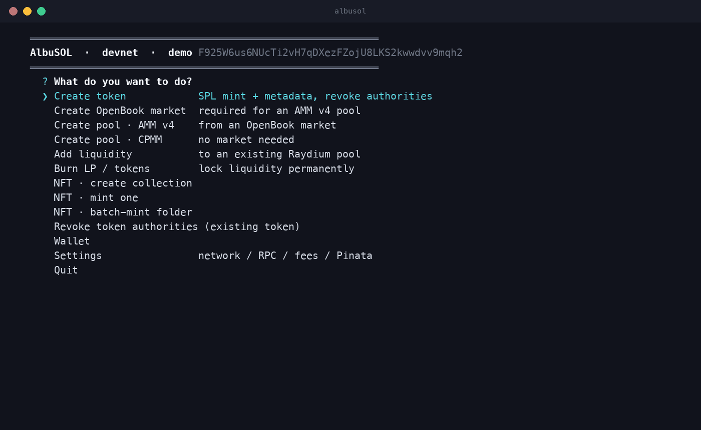

# AlbuSOL

[](https://www.npmjs.com/package/albusol)
[](https://github.com/AlbuStudio/albusol/releases/latest)
[](LICENSE)
[](https://nodejs.org)
[](#verified-on-devnet-2026-10-10)
[](#why-not-a-web-launcher)

A local, interactive Solana launch desk. One terminal menu for the whole
token lifecycle, signed with a private key that never leaves your computer.



```bash
npx albusol
```

Download: **https://albustudio.com/albusol** · Source: **https://github.com/AlbuStudio/albusol**

| Menu item | What it does |
|---|---|
| **Create token** | SPL mint + Metaplex metadata, mints the supply, optionally revokes mint / freeze authority and locks metadata |
| **Create OpenBook market** | Serum-v3 style market (needed only for Raydium AMM v4), minimum-rent queue config by default (~0.35 SOL) |
| **Create pool · AMM v4** | Raydium AMM v4 pool from a market; you set the launch price with the two deposit amounts |
| **Create pool · CPMM** | Raydium CPMM pool, no market needed, choose a fee tier |
| **Add liquidity** | Deposit into any existing AMM v4 or CPMM pool with slippage control |
| **Burn LP / tokens** | Real burn (supply goes down). Burning 100 % of LP locks the liquidity forever |
| **NFT** | Metaplex Core: create collection, mint one, or batch-mint a folder (resumable) |
| **Wallet** | Import (base58 / JSON / keypair file), create, switch, export, delete; devnet airdrop |
| **Settings** | mainnet / devnet, custom RPC, priority fee, Pinata JWT for IPFS hosting |

## Why not a web launcher?

Every browser launchpad asks you to connect a wallet to *their* site and sign
transactions *they* build. If their frontend, their CDN or one of their
dependencies is compromised, the transaction you approve is not the one on the
screen. AlbuSOL is the opposite shape:

- **Your key stays on your machine**, encrypted at rest, decrypted into memory
  only after you type the password, and used only to sign transactions that
  this code built. There is no server side.
- **Every transaction is built from source you can read** (`src/`, about 1,500
  lines of plain JavaScript, MIT). The only network calls are to the RPC you
  chose and, if you opt in, to Pinata for metadata hosting.
- **Nothing is hidden in the fee.** The service fee is a separate SOL
  transfer, printed on every confirmation screen before you say yes, sent only
  after the action succeeds, and lives in one 40-line file (`src/fee.js`).
- **Rehearse on devnet first**, with a built-in airdrop, then flip the network
  in Settings and run the same steps on mainnet.

> **Use your own RPC.** The public `api.mainnet-beta.solana.com` /
> `api.devnet.solana.com` endpoints throttle after a few dozen requests and a
> pool creation makes about forty. Put a free Helius, QuickNode or Triton URL
> in **Settings → RPC** before launching anything real.

## Install

```bash
npx albusol          # runs the latest release, nothing to install
```

or install it once:

```bash
npm install -g albusol
albusol
```

or from the zip on https://albustudio.com/albusol:

```bash
unzip albusol-<version>.zip && cd albusol-<version>
npm install
npm start            # or: node bin/albusol.js
```

Node 20+ required (macOS, Linux or Windows).

Every release zip is published with its SHA-256 in `latest.json` next to the download and on the [GitHub release](https://github.com/AlbuStudio/albusol/releases). Check it before you run anything that signs with your key:

```bash
shasum -a 256 albusol-<version>.zip
```

## Wallet security

Keys are stored in `~/.albusol/wallets/<name>.json`, encrypted with
scrypt (N=2^15) + AES-256-GCM under a password you choose. They are decrypted
into memory only after you type the password at start-up. Nothing is sent
anywhere except signed transactions to the RPC you configured.

Set `ALBUSOL_HOME=/some/dir` to use a different store (handy for test wallets).

## Metadata hosting

Token and NFT metadata must be reachable by wallets/explorers. Either:

- paste a URI you already host, or
- put a **Pinata JWT** in Settings and AlbuSOL uploads the image and the JSON
  to IPFS for you.

## Recommended launch order

1. Settings → pick network (test everything on **devnet** first) and an RPC
   with decent limits (Helius / QuickNode / Triton free tiers are fine; the
   public mainnet RPC rate-limits).
2. Create token (revoke mint + freeze).
3. Either **Create pool · CPMM** (simplest, one transaction) or
   **Create OpenBook market → Create pool · AMM v4**.
4. Burn LP to lock liquidity, if that is the promise you make to holders.
5. Mint NFTs whenever.

## Scripted / unattended mode

Every prompt can be answered from a JSON array instead of the keyboard:

```bash
ALBUSOL_ANSWERS=answers.json node bin/albusol.js
```

Answers are consumed in prompt order; for menus you can give the value
(`"token"`) or a substring of the label. See `test/devnet-smoke.sh`.

## Costs

AlbuSOL charges a flat service fee per completed action, paid to the Albu
Studio wallet `CGoCBQgPAYTPH29pYgLx6E6FbWRN1dSJbct4UijQJe3g` in a separate
transaction **after** the action succeeds (a failed action is never charged).
The fee is printed in every confirmation screen before you say yes.

| Action | AlbuSOL fee | Network cost (mainnet, approx.) |
|---|---|---|
| Create token | 0.05 SOL | ~0.02 SOL rent |
| OpenBook market | 0.05 SOL | ~0.35 SOL rent (minimum config) |
| AMM v4 pool | 0.10 SOL | 0.15 SOL Raydium fee + ~0.5 SOL rent |
| CPMM pool | 0.10 SOL | per fee tier (shown in menu), ~0.15 SOL |
| Add liquidity | 0.02 SOL | ~0.00001 SOL |
| Burn | 0.01 SOL | ~0.00001 SOL |
| NFT collection | 0.02 SOL | ~0.003 SOL |
| NFT mint | 0.005 SOL | ~0.003 SOL |
| Batch mint | 0.002 SOL per asset | ~0.003 SOL each |

Fees live in `src/fee.js`.

## Status

**Verified on devnet only** (two full passes, 2026-10-10). Mainnet uses the same
code with Raydium's mainnet program IDs but has not been exercised by the
authors; start small.

## Verified on devnet (2026-10-10)

Token `G2hD9UyALpJemw1ZGYXUJ2wktkdgBeKadgmP3PmHfAof` → CPMM pool
`DVBEfYN8i6Bez9fiMZdm9pCwXFHSYfFMZ7oHWPH3P3qz` → LP burned to 0 → OpenBook
market `GhicT71JDdGhVL3RoZkxnUN1jfF9tWo4Zd22oFNvHQuX` → AMM v4 pool
`FikuDp7YtSoNekm13ZfM8B3h9iUBxfJgAwH6hYJsVYRv` → add liquidity (both pool
types) → 50 % LP burn → Core collection
`DXLLfXvWqLvXSh2p3cRvfrUmcvAAtH3r8SyqV6dUJfNG` + 2 assets. Every step paid its fee.

## Notes and gotchas

- OpenBook market creation is **two transactions**; the second cannot be
  simulated until the first lands. A failed second tx strands ~0.004 SOL of
  vault rent — just retry.
- Raydium pool creation on mainnet goes through Raydium's fee account; those
  SOL are not refundable.
- The burn uses `BurnChecked`; LP supply reaching 0 means nobody — including
  you — can ever withdraw that liquidity.
- Public RPCs block `getParsedTokenAccountsByOwner` on some providers; if the
  burn screen shows nothing, switch RPC in Settings.

## Used by

Launched something with AlbuSOL? Open a pull request adding one line here (name, link, transaction).

## Security

See [SECURITY.md](SECURITY.md) for the threat model and how to report a vulnerability.

MIT · Albu Studio

## Disclaimer

AlbuSOL is a signing tool. Every action it performs is an irreversible
on-chain transaction that you authorise with your own key. Albu Studio does
not custody funds, cannot reverse anything, and gives no financial, legal or
tax advice. Creating and offering tokens may be regulated where you live
(in the EU see MiCA, Regulation (EU) 2023/1114); you are the issuer, not us.
